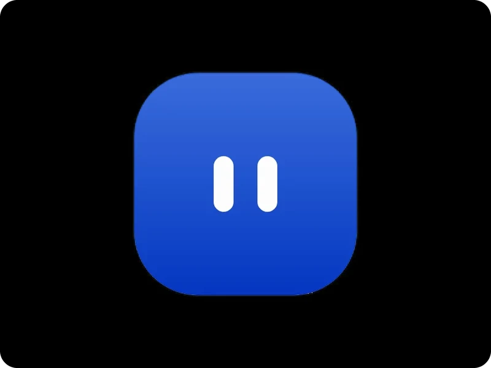
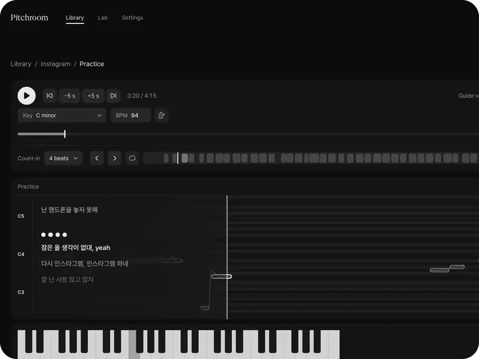
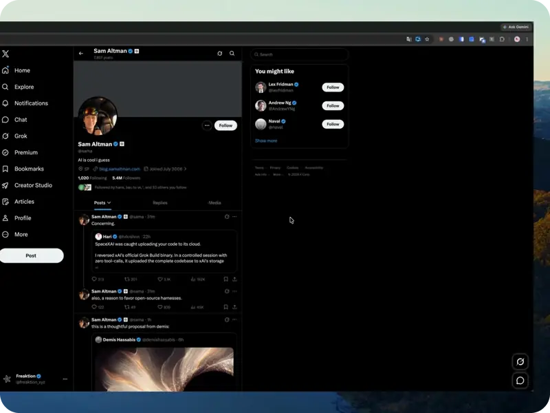

I design the software people work in all day, then build it. Lately: AI agents, design systems, and small tools that feel nice to touch.

  <a href="https://www.freaktion.xyz">
    <picture>
      <source media="(prefers-color-scheme: dark)" srcset="assets/logo-dark.webp">
      
    </picture>
  </a>

  
  
  
  

<a href="https://www.freaktion.xyz">freaktion.xyz</a> &nbsp;·&nbsp; <a href="https://x.com/freaktion_xyz">@freaktion_xyz</a> &nbsp;·&nbsp; <a href="mailto:f@freaktion.xyz">f@freaktion.xyz</a>
